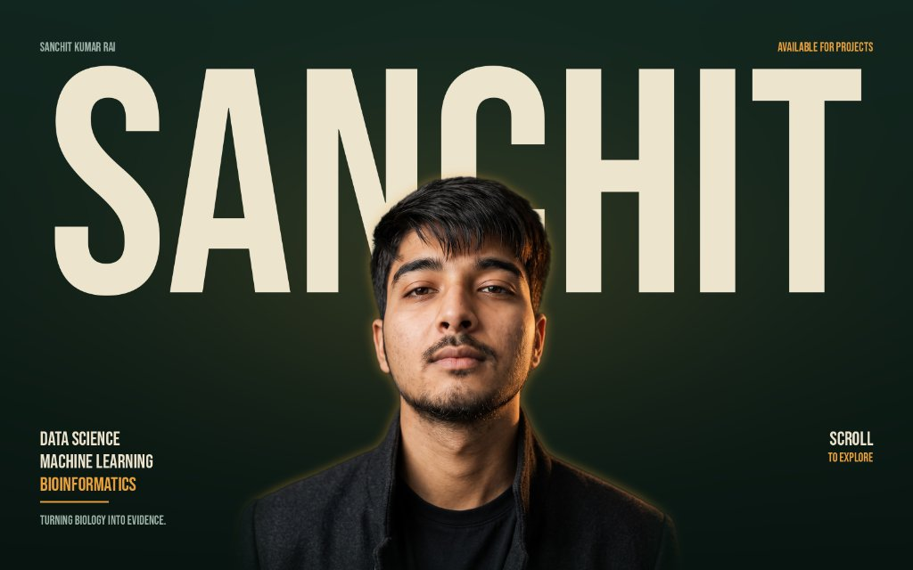

# Sanchit Kumar Rai — Portfolio

> **"Turning biology into evidence. Complex ideas, compelling digital experiences."**

A modern, high-performance portfolio website engineered for **Sanchit Kumar Rai**—computational biology researcher, machine learning engineer, and product designer from the University of Delhi.



---

## 🌟 Highlights & Features

- **Dark Spruce & Amber Luxury Aesthetic**: Custom dark-mode theme (`#0b140f`) with warm amber accents, cyber-lime signals, and glassmorphic card surfaces.
- **Interactive Data Waveform**: Real-time generative canvas plotting normal distribution curves and telemetry wave oscillations in the hero.
- **Dual Domain Architecture**:
  - **Data Science & Computational Biology**: Molecular docking affinity screening (*DockLens*), continuous glucose telemetry forecasting (*T2D Digital Twin*), in-browser data quality engine (*DataLens*), and real-time inference microservices (*NYC Airbnb Predictor*).
  - **Product Design & Web Engineering**: Conversion-engineered landing pages (*Gali Labs 92*, *Defender V8*, *Vedica*, *VØIDCULT*) with 3D component exploded views and design systems.
- **Ambient Soundscape**: Subtle Web Audio API harmonic soundscape toggle for ambient atmosphere.
- **Interactive Lightbox Modals**: Complete case study overlays with metrics, architecture notes, and live/GitHub links.
- **Interactive Contact Experience**: Project brief submission form, one-click email copying, and social media connectivity.
- **Automated GitHub Pages Deployment**: Fully automated GitHub Actions CI/CD workflow (`.github/workflows/deploy.yml`).

---

## 🔬 Featured Case Studies

| Project | Category | Key Metric / Tech |
| :--- | :--- | :--- |
| **DockLens** | Comp. Biology / ML | `CDK2 R²: 0.71`, AutoDock Vina, RDKit, Morgan Fingerprints |
| **Type 2 Diabetes Digital Twin** | Health Data / XGBoost | `2-Hour Early Warning`, CGM + Wearables, SHAP Attribution |
| **NYC Airbnb Predictor** | ML & FastAPI App | Real-time inference `< 25ms`, scikit-learn, Dusk Gradient UI |
| **BioEdge & Rosier AI** | EdTech / AI SaaS | Life-sciences conversational AI, React, Bio-Radar |
| **DataLens Studio** | Data Analytics | 100% Client-side CSV profiling & correlation matrices |
| **NextUp Roadmap** | Full-Stack / Data App | AI milestone roadmaps & salary benchmarks (₹14–25L) |
| **Gali Labs 92** | Luxury E-Commerce | 3D exploded view footwear architecture |
| **Defender V8** | Automotive Luxury UI | Interactive chassis breakdown & spec configurator |
| **Vedica Spring Water** | FMCG Showcase | Pristine Himalayan glassmorphism storytelling |
| **VØIDCULT** | Cyber-Brutalist Fashion | Manifesto & Lookbook streetwear experience |

---

## 🛠️ Tech Stack

- **Framework**: [React 19](https://react.dev/) + [Vite 6](https://vite.dev/)
- **Styling**: [Tailwind CSS v4](https://tailwindcss.com/)
- **Icons**: [Lucide React](https://lucide.dev/) & Custom SVG Brand Icons
- **Typography**: Instrument Serif, Plus Jakarta Sans, Space Grotesk, JetBrains Mono
- **Audio Synthesis**: Native Web Audio API
- **Deployment**: GitHub Pages & Vercel-ready

---

## 🚀 Getting Started

### 1. Clone the repository
```bash
git clone https://github.com/SanchitKRai/Sanchit-portfolio.git
cd Sanchit-portfolio
```

### 2. Install dependencies
```bash
npm install
```

### 3. Run development server
```bash
npm run dev
```

Visit `http://localhost:5173` to explore the site locally.

### 4. Build for production
```bash
npm run build
```

The compiled static assets will be generated in `dist/`.

---

## 📬 Contact & Links

- **GitHub**: [@SanchitKRai](https://github.com/SanchitKRai)
- **LinkedIn**: [linkedin.com/in/sanchit-kumar-rai](https://www.linkedin.com/in/sanchit-kumar-rai/)
- **Email**: `sanchit.kumar.rai.skr@gmail.com`
- **Fiverr (Data & Analytics)**: [Analyze Business Data & Build Dashboards](https://www.fiverr.com/s/qb5e94d)
- **Fiverr (Product UI/UX)**: [Modern Luxury Product Landing Pages](https://www.fiverr.com/s/DmQK7qX)
- **Location**: New Delhi, India

---

© 2026 Sanchit Kumar Rai. All rights reserved.
